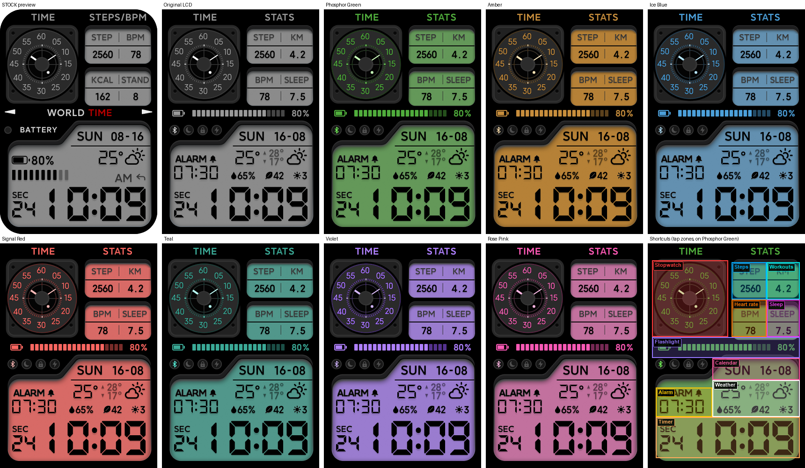

# Complex LCD+

Xiaomi Smart Band 10 Pro

Not affiliated with Xiaomi.

Design inspired by the stock Complex LCD face.

## Install

Install with [minstall](https://github.com/HyperionD/minstall).

Eight color styles, denser LCD weather/stats row, compact battery strip, and working tap shortcuts. Images use the band's stock RLE encoding (lossless); the download is about 4 MB.

- Bigger, clearer weather / high–low / icon row with humidity, AQI, and UV
- Next-alarm line in the LCD area
- Compact battery icon + segmented bar and percent
- Stats: steps, distance (km), heart rate, sleep (decimal hours)
- Tap zones for stopwatch, alarm, steps, heart rate, sleep, workouts, weather, calendar, flashlight, and timer
